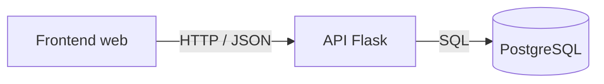
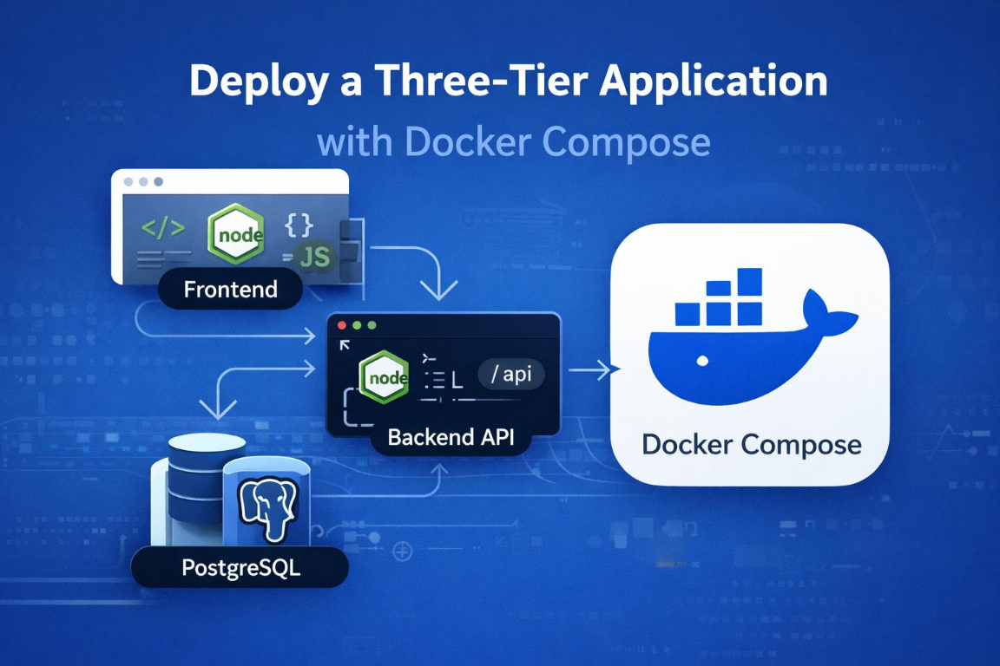

# Proyecto 1 — Docker + CI/CD

**Estado:** aplicación local disponible; reto DevOps pendiente.

## Objetivo

Partir de una aplicación mínima de tres capas y diseñar, implementar y demostrar su entrega. El código de aplicación está disponible; Docker, CI/CD, análisis de vulnerabilidades, publicación de imágenes y despliegue en una VM quedan como trabajo práctico.

## Requisitos de la aplicación

- Interfaz web para consultar y crear tareas.
- API REST que expone las tareas y comprueba la conexión con PostgreSQL.
- PostgreSQL como almacenamiento persistente de las tareas.
- Datos de ejemplo, instrucciones locales y pruebas automatizadas.
- Código de aplicación deliberadamente separado de la solución DevOps.

## Arquitectura



En desarrollo, el frontend estático y la API escuchan en puertos diferentes. El navegador llama a la API mediante `http://localhost:5000`; la API usa la URL configurada en `DATABASE_URL`.

### Referencia visual

La siguiente imagen sirve como referencia de la arquitectura objetivo con Docker Compose. Es ilustrativa: muestra Node.js, mientras que la aplicación de este proyecto usa Flask; además, Docker Compose todavía forma parte del reto por implementar. El diagrama Mermaid anterior refleja la aplicación actual.



## Estructura

```text
projects/01-docker-cicd/
├── backend/
│   ├── app.py
│   └── db.py
├── database/
│   ├── schema.sql
│   └── seed.sql
├── frontend/
│   ├── app.js
│   ├── index.html
│   └── styles.css
├── tests/
│   └── test_app.py
└── requirements.txt
```

## Ejecutar localmente

Requisitos: Python 3.10 o superior, PostgreSQL instalado y accesible, y `createdb`/`psql` disponibles.

Desde la raíz del repositorio:

```bash
createdb devops_learning
psql postgresql:///devops_learning -f projects/01-docker-cicd/database/schema.sql
psql postgresql:///devops_learning -f projects/01-docker-cicd/database/seed.sql

python3 -m venv .venv
source .venv/bin/activate
python -m pip install -r projects/01-docker-cicd/requirements.txt

export DATABASE_URL=postgresql:///devops_learning
PYTHONPATH=projects/01-docker-cicd/backend flask --app app run --port 5000
```

En otra terminal, desde la raíz:

```bash
python3 -m http.server 8080 --directory projects/01-docker-cicd/frontend
```

Abrí <http://localhost:8080>. Para verificar que frontend, API y PostgreSQL se comunican, comprobá que aparece la lista de tareas, agregá una y recargá la página. También podés consultar `http://localhost:5000/api/health` y `http://localhost:5000/api/tasks`.

`DATABASE_URL` debe apuntar a una base local que ya tenga aplicado `schema.sql`. `seed.sql` puede ejecutarse más de una vez sin duplicar las tareas iniciales.

## API

| Método | Ruta | Respuesta |
|---|---|---|
| `GET` | `/api/health` | Estado de la API y de la conexión con PostgreSQL; `503` si la base no está disponible |
| `GET` | `/api/tasks` | Lista de tareas |
| `POST` | `/api/tasks` | Crea una tarea; requiere JSON con `title` no vacío y de hasta 120 caracteres |

Ejemplo:

```bash
curl -H 'Content-Type: application/json' \
  -d '{"title":"Preparar el despliegue"}' \
  http://localhost:5000/api/tasks
```

## Pruebas

Desde la raíz del repositorio, con las dependencias instaladas:

```bash
PYTHONPATH=projects/01-docker-cicd/backend python -m pytest projects/01-docker-cicd/tests
```

Las pruebas automatizadas cubren las respuestas de la API y la validación de entradas. La comprobación manual con PostgreSQL verifica el recorrido completo de la aplicación.

## Checklist de entregables

El checklist de progreso de este proyecto se mantiene en el [README principal](../../README.md#proyecto-1-checklist-de-entregables).

## Problemas encontrados

Todavía no hay incidentes documentados. Agregá aquí el síntoma, diagnóstico, causa raíz, solución y aprendizaje cuando encuentres problemas durante la implementación.

## Decisiones técnicas y evidencias

- La aplicación usa Flask, PostgreSQL y JavaScript sin framework para mantener bajo el ruido de aplicación.
- El frontend y la API se ejecutan por separado en local para que la comunicación entre servicios sea explícita.
- No se incluyen archivos de Docker, pipelines, Terraform, Kubernetes o GitOps: construir esa capa es el reto del proyecto.
- **Evidencias de CI, imágenes y despliegue:** pendientes.
