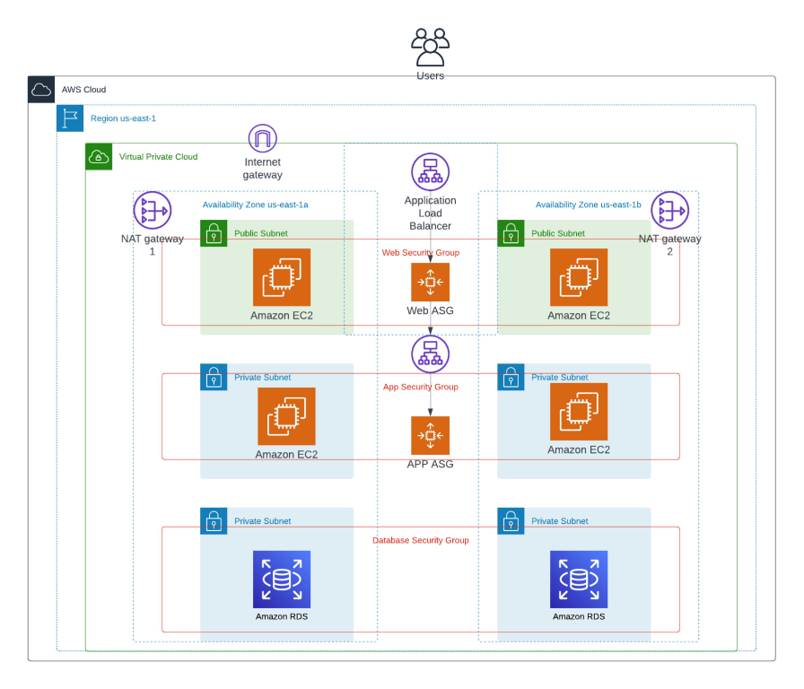

# Proyecto 2 — Cloud deployment

**Estado:** pendiente.

## Objetivo

Desplegar la aplicación del Proyecto 1 en una plataforma cloud y demostrar cómo se accede, opera y recupera el servicio.

## Alcance propuesto

- Elegir y documentar el proveedor y el modelo de despliegue.
- Desplegar la aplicación y registrar una URL o evidencia reproducible.
- Documentar red, acceso, configuración, secretos, costos y limpieza de recursos.
- Mantener aquí diagrama, instrucciones desde cero, decisiones técnicas y problemas encontrados.

## Referencia de arquitectura

La imagen muestra un ejemplo de arquitectura altamente disponible en AWS, con balanceador, capas de aplicación y base de datos distribuidas en zonas de disponibilidad. Sirve como referencia para evaluar opciones; no describe una infraestructura implementada en este proyecto. El diseño final deberá ajustarse al alcance, presupuesto y requisitos que se definan.

## Evidencias

Pendientes. No se han aprovisionado recursos cloud.
