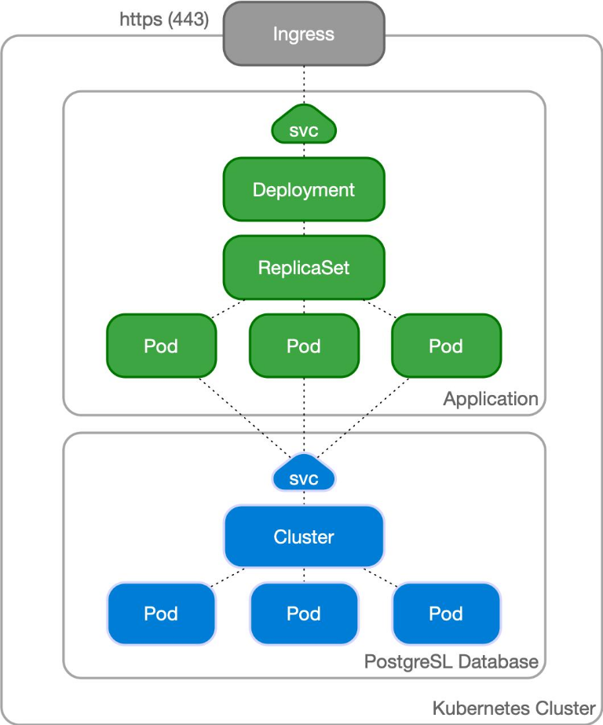

# Proyecto 3 — Kubernetes

**Estado:** pendiente.

## Objetivo

Desplegar la aplicación multicapa en K3s o Minikube y explicar cómo se comunican y recuperan sus componentes.

## Alcance propuesto

- Deployments, Services e Ingress.
- ConfigMaps, Secrets y almacenamiento persistente donde corresponda.
- Probes, recursos y réplicas.
- Empaquetado con Helm.
- Diagrama, instrucciones reproducibles, decisiones y registro de problemas.

## Referencia de arquitectura

El diagrama ilustra un Ingress que dirige tráfico HTTPS a la aplicación, con Services y Pods para la capa web y una base de datos PostgreSQL. Es una referencia conceptual, no una configuración implementada. En particular, ejecutar varias réplicas de PostgreSQL no garantiza por sí solo alta disponibilidad ni consistencia: el diseño final deberá definir almacenamiento persistente, replicación y recuperación, o usar una solución de base de datos adecuada para Kubernetes.

## Evidencias

Pendientes. No se han creado manifiestos ni clústeres.
