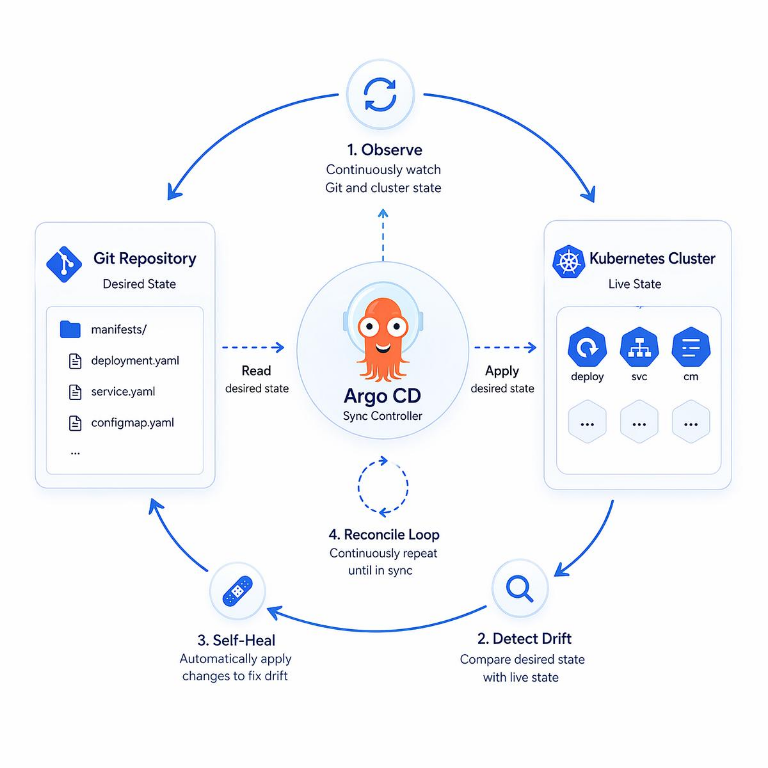

# Proyecto 5 — GitOps

**Estado:** pendiente.

## Objetivo

Automatizar la entrega a Kubernetes mediante un estado deseado versionado en Git y sincronizado por Argo CD.

## Alcance propuesto

- Construir, probar y publicar imágenes desde CI.
- Actualizar manifiestos o valores Helm en Git.
- Sincronizar cambios con el clúster mediante Argo CD.
- Provocar drift, observarlo y documentar su corrección.
- Mantener diagrama, instrucciones reproducibles, decisiones y problemas encontrados.

## Referencia de arquitectura

El diagrama ilustra el ciclo de reconciliación de Argo CD: compara el estado deseado almacenado en Git con el estado del clúster, detecta drift y sincroniza los cambios. Es una referencia conceptual; este proyecto aún no tiene una aplicación de Argo CD configurada.

## Evidencias

Pendientes. No se han creado aplicaciones Argo CD ni configuración GitOps.
