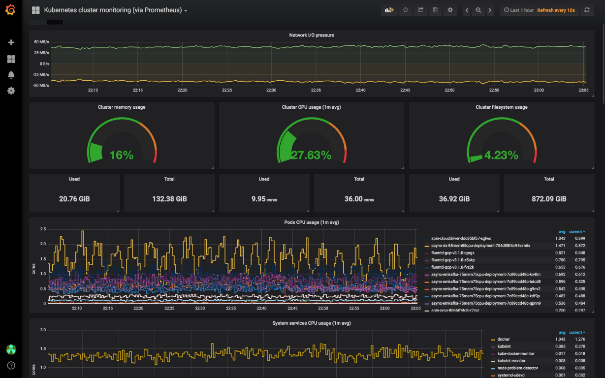

# Proyecto 6 — Production platform

**Estado:** pendiente.

## Objetivo

Operar la aplicación con observabilidad y controles de seguridad, y demostrar cómo se detectan y diagnostican fallos.

## Alcance propuesto

- Métricas y dashboards con Prometheus y Grafana.
- Centralización de logs y alertas accionables.
- Escaneo de imágenes y gestión de secretos.
- Simular fallos, registrar señales observadas, diagnóstico y remediación.
- Mantener diagrama, instrucciones reproducibles, decisiones y problemas encontrados.

## Referencia de observabilidad

La imagen muestra un ejemplo de dashboard de Grafana para monitorear un clúster de Kubernetes con métricas de red, memoria, CPU, almacenamiento y Pods. Es una referencia visual del resultado esperado, no evidencia de una plataforma desplegada en este proyecto.

## Evidencias

Pendientes. No se ha desplegado una plataforma de observabilidad.
